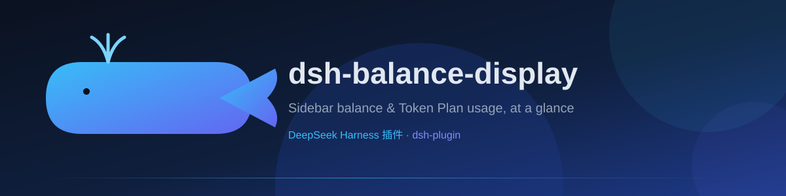

<div align="center">

# Balance display

**Every enabled DSH provider's wallet balance and Token Plan usage, at a glance in the sidebar.**

[](https://github.com/topics/dsh-plugin)
[]()
[]()
[](LICENSE)
[](CHANGELOG.md)

[English](README_EN.md) · [简体中文](README.md) · [dsh-plugin topic](https://github.com/topics/dsh-plugin) · [Changelog](CHANGELOG.md)

</div>



<div align="center">

Part of the **dsh-plugin** ecosystem · <https://github.com/topics/dsh-plugin>

</div>

---

## ✨ Features

One card, three sections, all fed by providers you have **actually enabled**:

| Section | Rows | Source |
| --- | --- | --- |
| **Token Plan** | Qwen · Lite, MIMO · Lite, OpenCode · Go, Z.ai, MiniMax… | the vendor's plan API / console session |
| **Balances** | DeepSeek, MiMo, Kimi, SiliconFlow… | each vendor's own endpoint (auth, endpoint count and units differ) |
| **Third-party** | WorkBuddy, Trae, Qoder · LobsterAI, Qoder 中国版, TRAE, Cline, Loomy, Raccoon, MiniMax Code, ZCode, Gemini | the installed `dsh-connect` plugin and our Free Model's **EAC router** page |

Providers you have not enabled never appear, and there is nothing to hide by hand.

- **Today's decrease** — the yellow `-¥0.42` before an amount is how much that wallet lost since midnight. A top-up is *not* counted as an increase; it only resets the anchor, so a refund never eats a day of consumption.
- **Colour** — a CNY balance below `10` turns amber, below `1` (negatives included) turns red.
- **Plan rows** — the plan name follows the vendor (`Qwen · Lite`), the yellow `↑4%` is the share of the plan used today, and the bar is this period's usage against the days left.
- **Nightly discount** — when the vendor's discount window is open, a green `Night · 40% off` tag appears after the plan name and lists the models it covers. Qwen's window and rate are scraped once a day from the model catalogue; MiMo's comes from the public Token Plan FAQ.
- **Peak hours** — a green/red dot after DeepSeek and MiMo balances shows whether you are in a peak window; hover for the times.
- **EAC router credits** — every channel on our Free Model's EAC router page gets its own row: `Credits left 1.2K`, `Balance (USD) $3.50`, `Tokens left`, or `Quota left` with a bucketed bar. Gemini's quota is never summed into a balance (its `total` adds percentages across model pools), and a channel without an account simply does not appear instead of showing a 0.
- **Folding is remembered per browser** — all three sections start folded; click a title to open just that one, and folding all three at once is allowed.
- **No settings gear** — configuration lives in **Settings → Plugins → Balance display**. A row missing a credential stays clickable, and an empty card offers a **Configure key** button, so setup is still reachable if the settings dialog is unavailable.

## 📦 Installation

### Option 1: Library Manager (recommended)

1. Open the **Library Manager** panel in DeepSeek Harness.
2. Switch to the **"My Projects"** tab.
3. Use **"Pull from account"** with `https://github.com/poloniumn/dsh-balance-display`, or **"Local import"** on the directory you cloned.
4. Put it into the **`dsh plugin`** folder.
5. **Restart DSH** — both the host half and the sidebar card load only at startup, so nothing shows up until you restart.

### Option 2: clone it yourself

```bash
git clone https://github.com/poloniumn/dsh-balance-display.git
```

Drop the cloned directory into DSH's `dsh plugin` directory, or from inside it run:

```bash
dsh plugin install .
```

<details>
<summary>From npm (optional)</summary>

```bash
dsh plugin install dsh-balance-display
```

</details>

The bundle inserts exactly one row (`dsh-balance-display`); nothing else needs configuring on the host side — the provider list is read straight from the `providers` in your `llm-pi-ai` configuration.

Every credential lives in the DSH credential store (`~/.dsh/.credentials.yaml`) and is never written into plugin config, logs or `localStorage`.

## 🚀 Usage

After installing and restarting, the card appears under the sidebar:

1. Click the **Token Plan**, **Balances** or **Third-party** heading to expand that section.
2. A row without a credential shows `No key / --`; clicking it jumps to the matching card on the settings page. Paste the value and hit **Save & test** — values are **validated before they are stored**, so a bad paste fails immediately instead of showing an empty row later.
3. The card refreshes every minute; on upstream failure it keeps the previous snapshot rather than flashing empty.

## ⚙️ Configuration

### One settings page, shared with dsh-model-panel

Both plugins read the same console cookies, so the credential page exists once. The host reads the local profile's `package.json` (`dependencies` and `dsh.profile.bundles`) to learn whether `dsh-model-panel` is actually loaded:

- **Installed and bundled** — that plugin's page is the only tab; this plugin registers nothing, so two identical pages never appear side by side.
- **Absent or not bundled** — this plugin registers the page in the same place (`Settings → Plugins`) with the same content and wording, so setup works either way.

The answer comes from `/dsh-balance/peers.json` (`state.json` carries a `sharedSetup` copy too) and is cached in `localStorage`, so it is asked once.

### Credential reference

The settings page is a full page of tabs, not a modal: every credential the plugin knows about gets its own card, grouped by kind (Token Plan cookies first, wallets after). Each card shows the masked value, the vendor console link, the balance or plan usage just read, and a paste box — Cookie-Editor's JSON export, a Netscape `cookies.txt`, or a raw `Cookie:` header all work, and you can drag a file straight onto the box.

| Credential | Where to get it |
| --- | --- |
| `DEEPSEEK_API_KEY` | <https://platform.deepseek.com/api_keys> |
| `QWEN_TOKEN_PLAN_COOKIE` | see "Qwen cookie" below — this one is a cookie, not a key |
| `XIAOMI_API_KEY` | <https://platform.xiaomimimo.com/console/api-keys> |
| `XIAOMI_TOKEN_PLAN_CN_API_KEY` | <https://platform.xiaomimimo.com/console/plan-manage> |
| `OPENCODE_GO_API_KEY` | <https://opencode.ai/console/workspace> (falls back to `OPENCODE_API_KEY`) |
| `ZAI_CODING_CN_API_KEY` / `ZAI_CODING_API_KEY` | Z.ai China / international site (the **two sites authenticate differently**) |
| `OPENROUTER_API_KEY` | <https://openrouter.ai/settings/keys> |
| `SILICONFLOW_API_KEY`, `NOVITA_API_KEY`, `HYPERBOLIC_API_KEY`, `DEEPINFRA_API_KEY`, `AI_GATEWAY_API_KEY` | each platform's API keys page |
| `NANOGPT_API_KEY`, `SYNTHETIC_API_KEY`, `CHUTES_API_KEY`, `OLLAMA_API_KEY`, `APIGOTO_API_KEY` | each platform's API keys page |
| `MINIMAX_CN_API_KEY` / `MINIMAX_API_KEY` | MiniMax China / international site |
| `ZENMUX_MANAGEMENT_API_KEY` | ZenMux **Management** key (inference keys cannot read quota) |

Kimi / Moonshot (`KIMI_API_KEY`, `MOONSHOT_API_KEY`) reuse the keys already in DSH's model routing, so there is no form for them; set them in the provider configuration instead.

### Alibaba (Qwen Token Plan) cookie

Qwen has no plan-usage API — the numbers sit behind a `platform.qianwenai.com` console session, so the plugin stores that console's `Cookie` request header.

1. Sign in at <https://platform.qianwenai.com/home/billing/subscription/token-plan>.
2. Open devtools → **Network** → pick any request to `platform.qianwenai.com`.
3. Copy the whole `Cookie` request header.
4. DSH → Settings → Plugins → Balance display → "Qwen Token Plan console cookie" → paste → Save & test.

The cookie expires in roughly 7 days; when you see "session expired", copy it again. From a terminal:

```bash
npx dsh-balance-qwen-cookie --paste      # hidden input, validate, then store
npx dsh-balance-qwen-cookie --from-copy  # read it straight from the clipboard
npx dsh-balance-qwen-cookie --check      # is the stored credential still valid?
npx dsh-balance-qwen-cookie --remove
```

### Which providers show up

Only those actually enabled in your DSH configuration: the plugin reads `providers` from the `llm-pi-ai` entry (including the inherited / override layers) and keeps every entry without `disabled`. DSH sign-in itself provides `deepseek-account`; third-party channel rows appear only when `dsh-connect` is installed, and our Free Model's EAC router credit rows only when it is.

The provider-id to adapter mapping lives in [`lib/registry.js`](lib/registry.js); a provider without an adapter still appears as a console link. To add a vendor see [docs/adding-a-provider.md](docs/adding-a-provider.md) — it is essentially one small file.

### How the numbers are fetched

The vendor API contracts come from [dsh-subusage 0.24.5](https://github.com/KouzakiUmi/dsh-subusage) (KouzakiUmi, MIT; attribution in [NOTICE](NOTICE)).

One `GET + Authorization: Bearer` does not fit every vendor. The host-side [`lib/upstream.js`](lib/upstream.js) owns the request; adapters only declare endpoints, auth mode and pure parser functions ([`lib/providers/vendors.js`](lib/providers/vendors.js)):

| Shape | Examples | Handling |
| --- | --- | --- |
| Raw `Authorization` | Z.ai international, Ollama Cloud | `auth: 'raw'`, no `Bearer` |
| `x-api-key` + POST | NanoGPT balance | separate `POST {}` endpoint on the management key's other host |
| Cookie session | Qwen, MiMo console | `auth: 'cookie'` plus Origin / Referer |
| Two endpoints, partial-failure fallback | OpenRouter, ZenMux, Kimi, NanoGPT | primary mandatory, secondary `optional: true`; a 403 there drops the secondary detail, not the row |
| Business error code inside a 200 | MiniMax `base_resp.status_code` | `check()` maps it to `expired` / `error` |
| Wildly different units | Novita 1/10000 USD, Hyperbolic cents, DeepInfra negative balance, Vercel decimal strings | each `parse()` converts explicitly, no generic scaling |
| One key, two reference names | OpenCode Go | `secret.aliases` tried in order, never merged across sources |

Shared guardrails (every request through `lib/upstream.js`): 10 s timeout, `redirect: 'manual'`, 1 MiB response cap; 3xx is never mistaken for an expired credential, 401/403 → `expired`, 408/429/5xx marked retryable, a non-JSON response means the session died. A few hand-written adapters still use the generic `getJson` with an 8 s timeout.

`kimi-coding` tries the subscription-quota endpoint first (4 s timeout) and falls back to the Moonshot wallet, so both subscription and open-platform keys produce numbers.

The EAC router channels are a different shape: our Free Model exposes no HTTP route for channel credits, so [`lib/ofm-credits.js`](lib/ofm-credits.js) reads the same `usage.badge` it uses itself — through the host's in-process Connection (`createPeer` + `createSharedFetchHandler('/api')`), because a bare loopback `fetch` to `/api/*` carries no session and gets rejected by the gateway. `usage.badge` rather than `credits.balances` because the former is host-cached and only covers enabled accounts, so the card's per-minute poll cannot multiply upstream requests.

Still **not** ported are the vendors that depend on local OAuth login files, QR scans or IAM signatures (Grok, Codex, GitHub Copilot, Volcengine Ark, Command Code) — they need the host's login and credential-log services, which one HTTP request cannot replace.

### Privacy and network calls

- Credentials are only sent to the address the vendor adapter declares, with a timeout, and never to a URL supplied by the browser.
- The state endpoints are reachable only from the DSH window: loopback host, loopback (or missing) origin, non-cross-site `Sec-Fetch-Site`, plus the host's own `connection.requestRejection`.
- The write endpoint (`POST /dsh-balance/secret`) accepts a single value, validates it, and stores it in the DSH credential store; it never returns plaintext, so the settings page only ever sees a mask like `oc_…9F (41)`.
- Beyond your configured vendor endpoints, the plugin only reaches: two public documentation pages (DeepSeek pricing, the MiMo plan FAQ, once a day), Qwen's model catalogue (once a day, when the discount window opens), the local `dsh-connect`, and our Free Model's own `/api/channel-pack` (through the host's in-process Connection, off the network, reading only the `usage.badge` it already caches).

### Data files

Caches live in `<DSH_HOME>/dsh-balance-display/` (`~/.dsh/…` by default):

| File | Contents |
| --- | --- |
| `baseline.json` | each row's anchor for the day, used to compute "today's decrease" |
| `schedules.json` | peak / nightly windows scraped from public pages |
| `qwen-discount.json` | the Qwen discount label and when it was read |
| `last-state.json` | the last snapshot that actually had data: used when the credential store is not ready yet, and never corrupts the cache |

Delete that directory to reset to a clean state.

## 🖼 Screenshots

<!-- Screenshot area: drop png/jpg into this repository's images/ directory, then use the grid below. -->

> **Screenshots are still being collected.** This repository ships none yet. Drop them into the `images/` directory of this repository (or into the publish workspace and ask me to lay them out), then replace this note with the grid below — two responsive columns, and card screenshots on a dark background look cleanest.

<!--
<table>
  <tr>
    <td align="center" width="50%">
      <br>
      <sub><b>Sidebar card</b> · Token Plan, balances and third-party channels</sub>
    </td>
    <td align="center" width="50%">
      <br>
      <sub><b>Settings → Plugins → Balance display</b> · one card per credential, validated on paste</sub>
    </td>
  </tr>
  <tr>
    <td align="center" width="50%">
      <br>
      <sub><b>Plan rows</b> · nightly-discount tag and the day's usage share</sub>
    </td>
    <td align="center" width="50%">
      <br>
      <sub><b>Today's decrease</b> · the yellow <code>-¥0.42</code> and low-balance colours</sub>
    </td>
  </tr>
</table>
-->

## 🧪 Development

```bash
npm test    # node --test, no dependencies
```

Layout:

```
index.js            host half (Cordis plugin serving /dsh-balance/*)
client.js           browser half, registering the card in sidebar.footer.action
lib/                fetching, routes, snapshots, credentials, schedules
lib/providers/      one adapter per vendor
tools/              the qwen-cookie CLI and the test runner
docs/               adding-a-provider guides (EN / ZH)
cordis.patch.yml    the bundle row
assets/banner.svg   the README banner
images/             README screenshots
```

## Credits

The vendor API contracts follow [dsh-subusage 0.24.5](https://github.com/KouzakiUmi/dsh-subusage) (KouzakiUmi, MIT); the required attribution is kept in [NOTICE](NOTICE).

## 📄 License

[MIT](LICENSE) © 2026 poloniumn

<div align="center">

[⬆ Back to top](#balance-display) · [dsh-plugin topic](https://github.com/topics/dsh-plugin)

</div>
